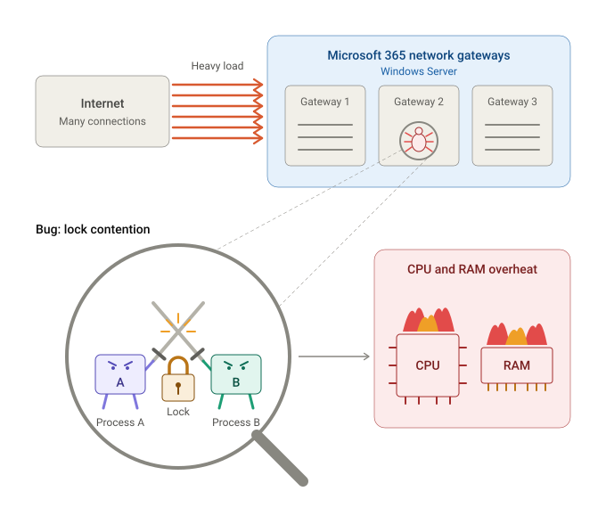
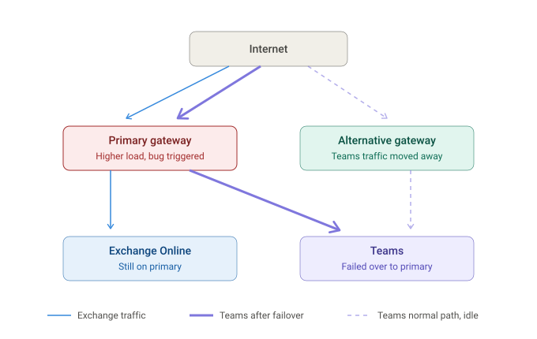
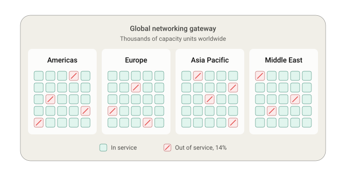
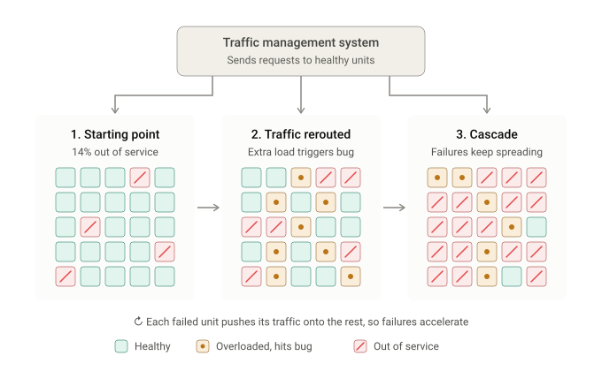

On Thursday, November 12, 2026, most Exchange Online users lost access to their mailboxes. Outlook would not connect, mail arrived hours late, and the parts of Microsoft 365 that lean on Exchange Online stumbled with it. Service was back to normal about 24 hours later.

Microsoft published a preliminary Post Incident Report (PIR) on November 15. This post tries to explain it in simple terms and with visual aids.

The short version: no single thing broke. A chain of multiple different issues caused the global outage.

<!--truncate-->

## The outage at a glance

| What | Detail |
| --- | --- |
| Start | Thursday, November 12, 16:20 UTC |
| End | Friday, November 13, 16:10 UTC |
| Duration | 23 h 50 min |
| Hardest hit | Exchange Online: mailbox access through Outlook, Outlook on the web, ActiveSync and the APIs, plus delayed mail delivery |
| Also affected | Features of Copilot, Teams, SharePoint, OneDrive, Defender, Purview and others that depend on Exchange |
| Worst point | More than 80% of gateway servers unresponsive |
| Root cause | A lock contention bug in Windows on the gateway servers, deployed since July |
| Fix | An update that reverts the July change, applied region by region |
| Incident IDs | EX1550543 and MO1550821 |

All times in this post are UTC.

## One front door, shared by almost everything

Every request to Microsoft 365 passes through a networking gateway before it reaches the service behind it. Think of it as the front door. It accepts your connection and hands it to Exchange, Teams or SharePoint.

Microsoft runs two of these gateway systems. They are built differently on purpose, so a fault in one is unlikely to exist in the other, and many services can move between them when one has trouble. According to Microsoft the one that handles the traffic from Exchange Online is called the "primary" gateway.

The primary gateway is made of thousands of "capacity units". Each unit is a slice of servers and network gear, and the units are grouped into regions. Two safety ideas come with that design, and both matter later on:

- If a server stops answering, traffic management sends its users to a healthy "capacity unit".
- Regions are separated by "bulkheads", so trouble in one region stays in that region.

Three things had to line up to get past all of that. Here they are, one at a time.

## Ingredient one: a bug that slept for four months

In July, Microsoft began rolling out a change to Windows on its gateway servers. It was a fix written specifically for these servers, and neither the fix nor the problem it addressed exists in ordinary Windows installations. The rollout went through staged deployment, reached every region over several weeks, and showed no problems.

The fix carried a defect of its own: lock contention.

A lock is how software stops two tasks from changing the same thing at once. Picture a single key to a shared storeroom. One worker takes the key, does the job and hands it back, and everyone else waits. With a few workers that is fine. With hundreds of workers and one key, most of them spend the day standing in the queue.

That is what happened inside the Windows process that sets up new connections. Under the right kind of load, tasks piled up waiting for the same lock. The machine ran out of CPU and memory, and it stopped answering.

*Under heavy load, tasks on a gateway server fight over the same lock. CPU and memory are used up, and the server stops answering.*

### Why testing missed it

The contention gets worse the more CPU cores a server has, because more cores mean more tasks reaching for the lock at the same moment. Microsoft's load tests ran mostly on older hardware with fewer cores, and with a traffic mix that differed from production.

So the bug passed every test and then ran worldwide for more than three months without a single symptom. The newest and most powerful servers were the ones most exposed to it.

## Ingredient two: Teams moves in

At 01:07 UTC on November 12, about fifteen hours before the outage, an automated system moved Teams traffic off the alternative gateway and onto the primary one. Nothing was wrong with that decision. Moving services between the two gateways is routine, and it is how Microsoft normally rides out smaller disruptions.

It did change two things on the primary gateway. There was more traffic, and it was a different mix of traffic. Both made the lock contention more likely.

*After the failover, the primary gateway carries both Exchange and Teams. The alternative gateway, the normal path for Teams, sits idle.*

Through the morning and early afternoon the load kept slowly increasing. Isolated servers began to fail in some regions, and automation patched around them.

## Ingredient three: one server in seven was already offline

Nearly 14% of the primary gateway's server capacity was out of service that day, because of an unrelated issue from the day before. Those servers were on their way back through normal maintenance.

*A simplified view of the primary gateway on November 12: capacity units grouped into regions, with about 14% out of service. The regions shown are illustrative.*

On its own this was harmless. The gateway is built with spare capacity, and losing 14% still left enough headroom for a normal day.

It did mean that the usual traffic, plus Teams, was now spread across fewer machines. Each remaining server worked a little harder, and each one sat a little closer to the load at which the July bug wakes up.

## How a few failed servers became a global outage

Around 16:00 UTC the daily traffic peak in the United States arrived. More load, fewer servers, and a bug that only shows itself under load. Servers began to lock up in numbers.

This is where the gateway's main safety mechanism turned against it. When a server stops responding, traffic management moves its users to healthy servers. That is the right call almost every time, and it happens constantly without anyone noticing.

This time, every healthy server that took on extra users moved closer to the same bug. It locked up too and passed its users on to the next one.

*Each failed unit hands its traffic to the ones still running, which pushes them into the same bug.*

The result was a chain reaction. In under two hours the defect had been hit across the fleet, and at the lowest point more than 80% of servers were unresponsive.

### The walls that did not hold

The bulkheads between regions should have stopped the spread at a regional border. They did not. Microsoft says only that this was "due to a separate issue" and leaves the detail for the final report.

For anyone judging the architecture, this is the biggest open question in the document. A bug that takes down one region is a bad day. The same bug taking down every region at once is a different class of problem.

### Who could leave, and who could not

Teams, OneDrive, SharePoint and the Office apps moved off the failing gateway. That is why they came back earlier, and why Teams chat and meetings kept working for most of the outage.

Exchange Online could not follow. Microsoft says it cannot fail out of this gateway "for scale reasons", so its users stayed behind and waited for a repair.

## Why the fix took almost a full day

Fifteen hours passed between the first alert and the first fix that worked. Rolling that fix out took another nine. Three things made this outage unusually hard to undo.

First, restarted servers drowned straight away. A freshly restarted server came back healthy, received the flood of waiting traffic, and locked up again. Engineers confirmed this pattern at around midnight, more than seven hours in.

Second, the automation had never been built for this. Microsoft's recovery tooling brings back a failed slice of the fleet while the rest carries the load. It was not designed for a state in which most of the fleet is down at once.

Third, there was nothing to roll back. Rollbacks, staged rollouts and feature flags all protect against recent changes. This one was four months old and fully deployed, so none of the quick undo buttons applied.

### Finding the real cause

The symptoms pointed in the wrong direction for a while. The servers that were still running showed high load, but by dinner time engineers had established that traffic was normal and the missing servers were the problem.

The next attempts went after failing health checks. They brought a small subset of servers back and then stalled. By nightfall Microsoft concluded that nothing so far had worked and widened the investigation.

The breakthrough came very early morning on Friday, when the team traced the failures to the step where a connection is negotiated. About two hours later they also switched off some of the automatic traffic redirection that had been spreading the load around. By morning they had an update that put the old code path back.

### Bringing it back carefully

Patching a fleet that falls over the moment it takes traffic needs patience. Engineers pulled large groups of servers out of service, in some cases more than half a region at a time. They patched and restarted them, and only then let traffic back in.

Regions that were in or entering their business day went first. Europe was back to healthy levels at 11:35, and Microsoft declared the customer impact over at 16:10.

## What Microsoft has changed so far

The preliminary report lists five actions as completed:

- The connection handling code on the gateway servers is back at its previous known-good state.
- The email delivery window was extended, so delayed messages were delivered and not bounced as undeliverable.
- Extra capacity was added to support recovery.
- New monitoring watches traffic-redirection patterns and the health of connection handling.
- Guardrails now limit how traffic is redistributed, to keep one failure from cascading.

A full list of repair items is promised with the final report, dated November 20, 2026.

Several questions are still open, and the final report should answer them:

- Why did the bulkheads between regions fail to contain the cascade?
- What was the unrelated issue that took 14% of capacity out the day before?
- What was the July fix meant to solve, and can that problem now come back?
- How will load testing change so that it covers the hardware and traffic that production really sees?

## What to take from this for your own systems

Microsoft's long-term fixes will come with the final report. The pattern is familiar enough that a few lessons can be drawn already. These are my readings of the incident, not statements from Microsoft's report.

**Failover moves load. It does not remove it.** The Teams failover and the traffic redirection both worked as designed, and together they pushed traffic onto the servers least able to take it. When you test a failover, test the place where the traffic lands.

**Test on the hardware you run.** A bug that only shows on machines with many cores will pass every test on small ones. The same applies to the traffic mix.

**Know how old a change your rollback can undo.** Flags and staged rollouts cover days or weeks. A defect that surfaces after four months needs a new fix, written and shipped under pressure.

**Plan for the cold start.** Bringing a service back from mostly down is a different job from replacing one failed node, because the waiting users all arrive at once. You need a way to let traffic back in gradually.

**If your organisation runs on Microsoft 365,** note what held and what did not. Email was the service that could not fail away, while Teams chat and meetings worked for most of the outage. That belongs in your emergency communication plan.

## Source

This post is based on Microsoft's Preliminary Post Incident Report for Microsoft 365, incidents EX1550543 and MO1550821, report date November 15, 2026. Microsoft has said a final report will follow within five business days of full resolution and will supersede the preliminary one, so details here may change.

## Disclaimer

I am not affiliated with, endorsed by or sponsored by Microsoft. This is an independent summary, and the opinions in it are my own.

Microsoft, Microsoft 365, Exchange Online, Outlook, Teams, SharePoint, OneDrive, Copilot and Windows are trademarks of the Microsoft group of companies. All other names belong to their respective owners.

I wrote this post from Microsoft's preliminary report and simplified it for readability. I make no guarantee that it is accurate, complete or current, and the diagrams are illustrations, not exact depictions of Microsoft's infrastructure. For anything you need to rely on, I refer you to Microsoft's own report.
